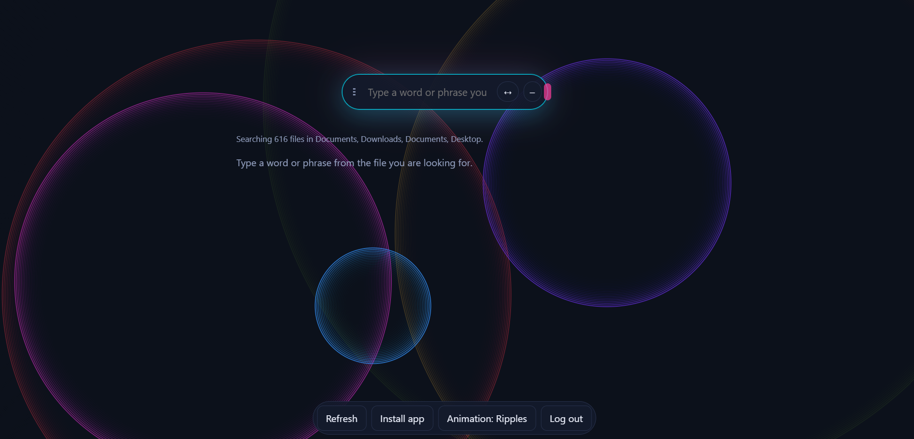

# CodeLens


A search engine for code and documents, **built from scratch in Python**: no search library, every data structure written by hand.

Search your own folders (code, text, PDF, Word, Excel) with ranked results, typo correction, autocomplete and phrase search, from a command line or a web page.

<!-- Put a screenshot or a short GIF of the search bar here. This is the single most useful thing in the README. -->


## What it does

- **Ranked search** (TF-IDF): rare words count more than common ones.
- **Typo tolerance**: `invertd` finds `inverted`, with a "showing results for..." line.
- **Phrase search**: `"sliding window"` only matches the words side by side, in order.
- **Autocomplete** while you type.
- **Understands code names**: `getUserName` and `max_file_size` are split into words, so `user name` finds `getUserName`.
- **Reads** `.py .js .java .md .txt ...`, plus **PDF, Word and Excel**.
- **Fast restarts**: the index is saved to disk and only changed files are read again.
- **Accounts and security**: hashed passwords, signed tokens, rate limiting, one private workspace per user.
- **A flexible search bar**: drag it, resize it, shrink it to a small orb; six switchable animated backgrounds.

## Quick start

```bash
git clone https://github.com/vishenpratham33-stack/CodeLens.git
cd CodeLens
python -m venv .venv
.venv\Scripts\activate   # Windows (Mac/Linux: source .venv/bin/activate)
pip install -r requirements.txt
python -m codelens serve --folder "C:\path\to\your\folder"
# open http://127.0.0.1:8000, create an account, and search
```

Command line only:

```bash
python -m codelens search . "inverted index"
python -m codelens search . "sliding window" --phrase
python -m codelens suggest . tok
```

Other ways to run it:

| Way | How |
|---|---|
| Docker | `docker build -t codelens .` then `docker run -p 8000:8000 -v codelens-data:/data codelens` |
| Windows app | download `CodeLens.exe` from the Releases page, double-click, choose a folder |
| Phone | `python -m codelens serve --host 0.0.0.0`, then open the address it prints (same Wi-Fi) |

## How it works

```
files --> crawler --> reader (text, PDF, Word, Excel) --> tokenizer --> inverted index --> saved to disk
                                                                              |
query --> tokenizer --> typo fix --> posting lists intersected --> TF-IDF --> heap (top K) --> results
```

| Part | Data structure or algorithm |
|---|---|
| Crawler | tree traversal (DFS) with pruning, generators |
| Index | hash map of hash maps, positional postings |
| Multi-word search | two-pointer intersection and merge of sorted lists |
| Ranking | TF-IDF, hand-written min-heap for the top K |
| Autocomplete | trie |
| Typos | edit distance (dynamic programming, early stop) |
| Phrases | positional index |
| Rate limiter | sliding window over a queue |
| Updates | change detection by size and modified date |

## Security

| Threat | Defence |
|---|---|
| Stolen user file | passwords stored only as scrypt hashes, with a random salt |
| Password guessing | slow hash, login rate limits, same answer for a wrong user and a wrong password |
| Forged login | tokens signed with HMAC-SHA256, with an expiry |
| Reading other people's files | one workspace per user; clients never choose a server path |
| Path tricks (`../`, shortcuts) | every path is resolved and checked to be inside the workspace |
| Malicious file names or sizes | file name allow-list, type allow-list, size limits |
| Script injection in the page | results drawn as text, never as HTML; Content-Security-Policy |
| Corrupt files | readers return nothing instead of crashing |

## Performance

Measured with `python scripts/benchmark.py 10000` on [describe your computer]:

| What | Result |
|---|---|
| Files | 10,000 |
| First build | [X] s |
| Search, median | [Y] ms |
| Search, 95th percentile | [Z] ms |

The benchmark uses generated files, not real code. The script is in `scripts/benchmark.py`, so anyone can run it and check.

## Honest limits

- The index lives in memory and is saved as one JSON file. For millions of files a database would be the next step.
- The server is plain HTTP. Put it behind HTTPS before using it over the internet.
- Scanned PDFs (pictures of pages) have no text and are not searchable.
- Typo search compares against the whole vocabulary, which is fine for thousands of words, not millions.

## Tests

```bash
pip install -r requirements-dev.txt
python -m pytest -q
```

[N] tests, run on every push with GitHub Actions.

## License

MIT
